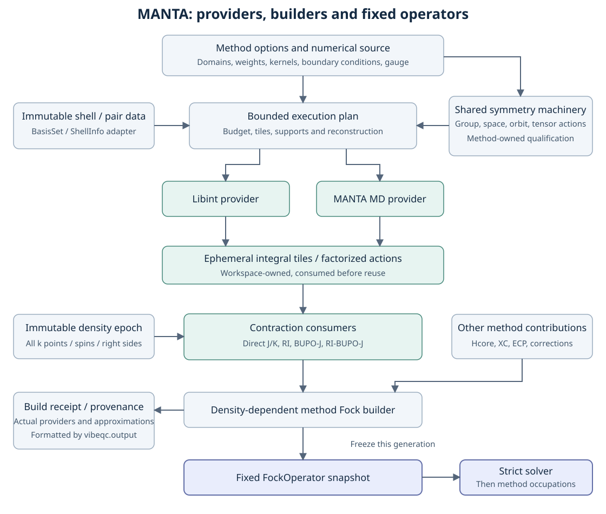

# MANTA: optional integral and Coulomb/Fock engine

Status: staged implementation, 2026-10-10. Current experimental molecular
and finite-source periodic HF/KS interfaces are documented in the
[MANTA manual](../user_guide/manta.md). The wider capabilities on this page
remain implementation and acceptance targets. No default change or performance
advantage is claimed.

MANTA is the working name for a native, optional Gaussian integral provider
and associated contraction kernels. It coexists with libint. Users select
the integral provider independently of the Coulomb algorithm and exchange
approximation. BUPO-J accelerates Coulomb construction; it does not supply K.

The design has three parts:

* This page: integration, interfaces, capability gates, ownership and routing.
* [Scientific contracts](manta_scientific_contract.md): equations, literature
  mapping, molecular BUPO, periodic extension, CCM identities and symmetry.
* [Implementation and acceptance](manta_validation_plan.md): ordered increments,
  numerical references, resource gates and performance measurements.

The periodic KS checkpoint now includes physical RKS/UKS, bounded cutoff
source generation and a separately admitted 3D atomic quadrature source.
Joint grid/domain/SCF admission and selected public RKS/UKS jobs are available,
including immutable evaluated snapshots, complete source receipts and
lossless QVF spin densities. A jointly admitted frozen-density grid assessment
now compares XC energy and every spin/k potential against a caller-selected
reference grid. It reports differences, not a continuum error bound or an
automatic accuracy certificate. An explicit-source global LDA/GGA hybrid
adapter now combines semilocal XC with scaled full-Coulomb exchange and an
explicit zero-mode convention. Hybrid cutoff domains reuse the shared HF
G/Q and physical pair source and separately admit XC images. A joint atomic
grid/domain/hybrid-SCF factory retains every source owner through confirmation.
Selected public hybrid jobs now preserve the exchange convention, scaled
component energies and exact evaluated spin density through standard output
and QVF. Explicit-source range-separated LDA/GGA RKS/UKS now resolves the full
signed Coulomb/erfc component list, including distinct ranges, finite screened
zero modes and a separately selected long-range singular correction. Shared
cutoff/grid factories now admit all range-separated components together with
their retained sources and confirmation builds. Selected public range-separated
jobs now preserve complete signed kernel receipts, actual/requested zero-mode
handling and the evaluated QVF spin density. An explicitly partial hybrid
grid diagnostic now compares semilocal energies and potentials at one frozen
density, retaining the required exchange descriptor and jointly admitted
grid owners. Energy/potential accuracy profiles
remain open. This checkpoint does not
qualify the remaining periodic fitted/BUPO,
low-dimensional, CCM/chi, symmetry, derivative/stress or acceleration rows below.

P3 primitive substitution now also includes jointly admitted raw erfc GDF
metrics and shared-q three-center blocks. The native MANTA evaluator uses the
existing GDF sphere/capsule image and screening selectors, with distinct
component identities and measured work. Independent analytic sums, libint
blocks, complex trial responses and high-angular radial/Fourier witnesses
qualify this short-range source. Complete finite Coulomb SR/LR blocks now also
combine MANTA auxiliary/AO-pair Fourier panels with the existing GDF jellium
kernel. Independent converged bare-Coulomb sums check splitting and zero-mode
assembly. Immutable shell tiles now feed a fixed complex positive projector
and streamed retained-mode Gamma J/transfer K consumer. Independent Gaussian
and libint references, energy derivatives, gauge transport, rank rejection
and joint resource admission qualify this component boundary. A whole-mesh
spin Fock consumer now composes the fixed Gamma and ordered transfer sources.
Explicit-source fitted UHF reuses the physical S/T/V/nuclear producers and
bounded spin solver, with independently checked correction, evaluated-density
and terminal-confirmation gates. A jointly admitted RI UHF cutoff factory now
generates pair-complete AO images and certified Gamma/off-diagonal reciprocal
spheres, preserving the fitted ket-minus-bra convention and fixed projector
owners. Selected scientific calls record complete fit and domain provenance
through the standard output layer. Public UHF jobs now admit explicit RI J
and RI K with a resolved auxiliary basis and independent fitting controls,
retaining evaluated spin densities through standard output and QVF. A shared
RI HF source now also feeds the actual bounded RHF leaf with spin-summed
closure and energy gates. Explicit/cutoff scientific calls and public RHF
jobs preserve the restricted evaluated density, fixed fit and source receipt.
Independent restricted references, retained-space/gauge tests and landed
FockBuild crossings qualify this finite subset. Fitted KS acceptance follows
below, including bounded physical range fitting. Source-specific symmetry
qualification remains required.
The whole-mesh RI consumer now also admits fixed independent J/K targets.
RI-J owns only the Gamma source and skips all exchange-transfer metrics;
RI-K preserves every required transfer and skips the Coulomb contraction.
Selected component/source identities and shared Fock/gauge tests establish
this component boundary without enabling reduction. Jointly admitted mixed
exact/RI RHF and UHF now compose either selected fitting target with the
complementary direct reciprocal producer. Explicit sources, generated cutoffs
and public jobs preserve the selected K transfer convention, both component
receipts, fixed fitting projectors and same-density method energy. Independent
SCF, capped-state, resource, gauge, QVF and shared Fock checks qualify this
finite subset. BIPOLE parity and source-specific symmetry remain separate gates.

Explicit fitted pure/global LDA/GGA RKS and UKS now reuse the functional
solver leaves with independently selected exact/RI J/K. Fixed projectors,
all component workspaces and the actual XC energy are jointly admitted.
Independent SCF, functional derivatives, capped epochs, truncated fits,
AO/auxiliary images and rectangular overlap spaces cross the landed Fock
and symmetry transport APIs. Existing direct KS density/snapshot identifiers
now separate the evaluated density from interaction selection; saved direct
numerics and source identities remain unchanged. Fitted KS cutoff/grid
factories now jointly admit certified geometric domains, retained atom-centred
quadrature and the actual functional solver. Independent integer spheres,
raw-fit SCF, budget boundaries, image transport and shared Fock exports qualify
these generated sources. Pure fitting generates no K table; global K keeps its
selected exact or fitted orientation and diagonal ownership. Public fitted KS
jobs now preserve those native sources and the existing RKS/UKS result types,
with complete output admission, owned functional state and evaluated-density
QVF in the nuclear AO frame. Independent public SCF, capped states, image
gauges, resource and output-lifecycle checks qualify this route. Physical range
fitting domain factories and public jobs, periodic BUPO and all unqualified
matrix rows remain required. Explicit bounded range fitting is described below.

The current periodic RI-BUPO increment shares call-wide pair charges and
auxiliary inputs, and projects summed auxiliary/pair fields once per source
panel. It reuses the ordered GDF producer, immutable Gaussian preparation,
bounded certified partitions and shared Fock path. It leaves the finite
metric, method-owned exchange/XC and source-specific symmetry unchanged.
The shared producer now supplies a global ordered pair tree, exact capsule
masks, complete auxiliary-image unions and source-owned Bloch-frame factors.
An opt-in global pair-tree contraction now consumes these APIs. It aggregates
only wholly included, separately Gaussian-certified far blocks and applies
paired upward/downward moment actions. Gamma coupling completes conjugate
pair orbits only after checking the literal finite support. The approximate
source has its own identity; the exact metric and method-owned K/XC remain
unchanged. This is a bounded pair-tree by auxiliary-image traversal, with
explicit accuracy controls. Per-shell-block error and magnitude ledgers now
preserve which contributions reach the same output and carry a Euclidean
forward bound into the fixed-metric RI energy/J estimates. They leave the
numerical source unchanged. The shared isolated erfc error model now also
uses a joint radial derivative envelope and interior absolute moments. This
changes accepted partitions and therefore versions approximate coupling
identities while preserving the exact metric and reference. Explicit tighter
tolerances are measured at fixed density and through complete SCF. Lossless
total-degree interaction storage and actual-entry cache charging now reduce
high-order partition rebuilds without changing the numerical source. Automatic
useful-accuracy profiles, a general production crossover and the remaining
P3b/0.18.x matrix are unfinished.
See the [pair-tree action benchmark](https://github.com/vibe-qc/vibe-qc/blob/main/benchmarks/manta_periodic_ri_pair_tree.md)
and the [explicit accuracy measurement](https://github.com/vibe-qc/vibe-qc/blob/main/benchmarks/manta_periodic_ri_accuracy.md).

## 1. Audit and integration decision

The inspected Fock/operator source is revision `e2a3947bb617`; the shared
symmetry reference is `80f9f392651e`. These are source-audit anchors, not release
or numerical acceptance evidence. The four requested design pages remain at
their original paths. The symmetry reference also contains newer GDF transport
diagnostics. Its in-progress GDF/IBZ edits are not prerequisites or accepted
behavior in this proposal. Reconcile their landed state at implementation time.

An exact-word, case-insensitive search of tracked repository content found no
existing MANTA symbol or product name. Reserve `vibeqc.manta` and
`vibeqc::manta` for this work; this is a repository naming check, not trademark
clearance. The initial implementation is independently written from published
algorithms. No ORCA code, paper PDFs, SI archives, or third-party GPU source is
to be bundled. Any later dependency or redistribution needs its own license
review under the repository rules.

| Inspected boundary | Finding and consequence |
| --- | --- |
| `cpp/include/vibeqc/basis.hpp`, `cpp/src/basis.cpp` | `BasisSet` owns a libint basis. `ShellInfo` exports each contraction with normalized coefficients. Pure functions use standard `m=-l..l`; Cartesian components use descending x, then y. Start with a lossless adapter, not a new parser or renormalization. |
| `integrals.hpp`, `integrals.cpp`, `fock.cpp` | Existing small-system `Eri4D` is a dense reference. Keep it for bounded tests; do not make it MANTA's production data model. |
| `jk_builder.hpp`, `jk_direct.hpp`, `jk_direct.cpp` | Reuse the existing molecular `JKBuilder` factory seam. Direct J/K already share quartet traversal. The interface has spin slots, incremental state, runtime thresholds and reset hooks despite historical immutable-builder comments. A `const` builder is not a frozen solver operator. |
| `df.hpp`, `df.cpp`, `density_fitting.py` | Raw 2c/3c kernels, metric factorization and fitted contractions have distinct roles. Dense factors and streaming consumers coexist; MANTA must offer tiles and actions rather than require full `Eri3D` or B storage. |
| `lattice_integrals.cpp`, `periodic_fock.cpp`, `lattice_pair_cells.hpp` | Multiple numerical image domains exist. Inspect function-level support, not the older Gamma-only header description. Preserve external AO-pair, density-pair and internal interaction domains separately, including exchange's AC/BD pairing. |
| `periodic_fock_multi_k.py`, `ewald_composed.py` | Whole-mesh J has an existing bounded Fourier route. Do not replace it with a molecular-limit Gamma density assumption. Reuse it as an independently implemented reference when conventions match. |
| `periodic_k_gdf.py`, `aux_basis.py`, `periodic_gaussian_fock.hpp` | q-dependent metrics, complex factor contractions and native resource plans already exist. The native finite-Gaussian response is not by itself a complete converged periodic Hamiltonian. Retain its source/context and work accounting. |
| `pbc_bipole_fock.py`, `bipole_domain.py`, `bipole_dispatch.py` | BIPOLE is a method/source family, not a synonym for BUPO. Active erfc/reciprocal and dormant multipole routes have different qualification. MANTA may replace admitted primitive kernels without enabling the dormant source. |
| `periodic/ccm/route.py`, `periodic/chi/scf.py`, `periodic_fitted_support.py` | Neutral real-Gamma, neutral Bloch, union-and-weight and chi have separate contracts. The same representation theorem applies only after specifying the same Hamiltonian. |
| `solvers/operators.py`, `hermitian_operator.hpp` | Reuse `HermitianOperator`, `FockOperator`, metadata, and the strict solver boundary. No new eigensolver API is needed. |
| `symmetry_shared.py`, `symmetry_ao.py`, `symmetry_gdf.py` in the symmetry reference | Reuse named spaces, compact actions, stabilizers, tensor transport and evidence. `passed_probe` is not `production_reduction_authorized`. |

The operator workstream's `docs/design/operator_contract.md` and
`docs/design/operator_consumers.md` are now integrated on main. MANTA export
crossing tests reuse those types. Bounded native kernels retain their admitted
storage and numerical leaf; zero-copy semantic adapters remain separate work. The
[shared symmetry design](../design_shared_symmetry.md),
[symmetry developer reference](../developer_shared_symmetry.md), and
[BIPOLE domain contract](../bipole_domain_contract.md) remain authoritative
for their layers. MANTA adds providers beneath them. It does not require a
repository-wide Fock rewrite before useful molecular work can land. The
initial libint reference adapter validates owned matrices directly; its
`FockOperator` integration gate awaits that independently developed foundation.

## 2. Architecture



Mermaid source showing the data flow, including the SCF loop:

```text
flowchart TD
    Input[Method and explicit calculation options] --> Source[Immutable numerical source contract]
    Basis[BasisSet and ShellInfo adapter] --> Shells[Immutable shell and pair data]
    Source --> Plan[Bounded execution plan]
    Shells --> Plan
    Sym[Shared group, space, orbit and tensor actions] --> Gate[Method-owned symmetry qualification]
    Source --> Gate
    Gate --> Plan
    Plan --> LI[Libint provider]
    Plan --> MA[MANTA MD provider]
    LI --> Tiles[Ephemeral integral tiles and factorized actions]
    MA --> Tiles
    Tiles --> Dig[Direct J/K, RI, BUPO-J and RI-BUPO-J consumers]
    Density[Immutable whole-density epoch] --> Dig
    Plan --> Dig
    Dig --> Build[Density-dependent method Fock builder]
    Other[Hcore, XC, ECP and method corrections] --> Build
    Build --> Frozen[Fixed FockOperator snapshot]
    Frozen --> Solve[Strict solver]
    Solve --> Occup[Method occupations and next density]
    Occup --> Density
    Build --> Receipt[Build provenance and numerical diagnostics]
    Receipt --> Output[vibeqc.output]
```

The provider evaluates mathematical kernels. The consumer contracts them.
The method owns the Hamiltonian, coefficients, finite support, boundary
conditions and energy. The solver sees a fixed linear operator. Symmetry
provides representations and a qualified schedule, without choosing a new
physical source.

### 2.1 Existing and proposed interfaces

The following C++ declarations are proposed internal interfaces, not new
exported ABI promises. Names other than the explicitly identified existing
types do not exist yet. Use spans/views appropriate to the project's C++
standard; do not add a language-version dependency just for this sketch.

```cpp
namespace vibeqc::manta {
struct ShellChannel {
    ShellId id;
    int l;
    Representation representation;       // Cartesian or real pure
    ExponentView exponents;
    CoefficientMatrixView contractions;  // primitive x radial channel
    Vec3 origin_bohr;
    NormalizationId normalization;
    AOIndexMap output_order;
};
struct KernelRequest {
    KernelKind kind;                     // S, T, V, moments, FT, Coulomb
    CenterArity arity;                   // 2c, 3c, 4c
    RangeKernel radial;                  // full, erf, erfc; omega in bohr^-1
    DerivativeSpec derivative;
    ShellImageTuple shells;              // exact integer images, no wrapping loss
    ScalarKind scalar;
};
struct IntegralTileView {
    TensorLayout layout;                 // axes, strides, conjugations, AO order
    ConstBuffer values;                  // valid only until next evaluate call
    PermutationDescriptor permutations; // no hidden degeneracy factors
};
class IntegralProvider {
public:
    virtual CapabilityResult supports(const KernelRequest&) const = 0;
    virtual WorkspaceRequirement workspace(const KernelRequest&) const = 0;
    virtual IntegralTileView evaluate(const KernelRequest&, Workspace&) const = 0;
};
class IntegralConsumer {
public:
    virtual DensityEnvelope envelope(const BatchDescriptor&) const = 0;
    virtual void digest(const IntegralTileView&, TargetPanelSet&) = 0;
};
struct BuildRequest {
    NumericalSourceHandle source;
    DensityEpochView density;            // all spin/k blocks, immutable during call
    TargetRequests targets;              // independent J, K, response right sides
    AccuracyBudget accuracy;
    ResourceBudget resources;
    ExecutionPolicy execution;
};
BuildPlan prepare(const BuildRequest&, const IntegralProvider&);
BuildResult execute(const BuildPlan&, const BuildRequest&, WorkspacePool&);
} // proposed internal namespace
```

`BuildResult` owns immutable output panels or a frozen linear action plus a
`BuildReceipt`. A method then assembles Hcore, J/K and XC and creates the
existing `FockOperator`. A frozen action captures the density epoch, supports,
coefficients and numerical plan by immutable ownership. It must not consult a
live SCF builder, incremental cache, changing threshold or current density.
Generation counters alone cannot fix mutable captures. A cancelled or failed
build returns no usable partial snapshot.

Initial molecular integration is a new `JKBuilder` implementation wrapping
this interface, preserving existing `build_J`, `build_K`, paired-spin, slot,
reset and range-separated behavior. Multi-k gets a separate whole-mesh
adapter, not repeated calls to the molecular one-density API. Consumer batches
can include Hermitian indefinite density differences and, in a separately
declared response mode, non-Hermitian transition densities. Positive
occupations are not an integral-engine precondition.

The factorized MD consumer API additionally accepts `contract_pair_density`,
`apply_hermite_coulomb`, and `project_pair_potential` operations. These may
bypass explicit integral tiles for J. A libint provider can supply the same
semantic action by digesting shell tiles. K uses distinct crossed contractions.
Small reference materializers have explicit dimension/byte caps and are never
an implicit implementation of an action.

### 2.2 Numerical source and provenance

A proposed `NumericalSourceContract` contains:

* geometry, cell, dimensionality, orbital/auxiliary basis and normalization IDs;
* physical method/source ID, finite domain membership and weights, screening
  and retained-space policy IDs, kernel coefficients and units;
* full k mesh and weights, Bloch/FT conventions, integer image maps and q wraps;
* Hartree gauge, net charge/background, surface boundary, nuclear self terms,
  and exchange singularity convention, all as separate fields;
* RI metric, auxiliary basis, retained projector/rank, solve tolerance, and
  any compensation/charge constraint;
* basis-pair support, interaction partition, bubble hierarchy, expansion-order
  policy and qualified symmetry-plan identity;
* schema/algorithm revisions and actual backend build identities.

Content identities bind actual numerical inputs and supports. A descriptive
string or source revision is useful provenance but does not authenticate a
tensor. Reuse the finite-Gaussian native context/receipt model where practical.
The shared symmetry `OperatorContract` is a compact declared projection of
this richer record; it is not replaced. Existing solver `OperatorMetadata`
retains basis, generation, spin and k-point annotations. Initially keep the
larger receipt beside the operator in the method result; adding a receipt ID
to public metadata is a separately reviewed additive change.

Cache identity is layered: geometry/basis for primitive data; plus kernel and
images for integral tiles; plus metric/cutoff/projector for fit data; plus
partition/order/symmetry for execution plans; plus all density blocks and spin
slots for incremental state. Changes invalidate the affected layer and its
dependents. Keep neither density caches nor factorization policy in solvers.

The current molecular C++ producer seam is `IntegralProvider` in
`manta.hpp`, implemented by `MantaProvider` and `LibintProvider`:
`source_identity()`, `kernel_request()`, and borrowed `evaluate`/`evaluate_batch`
tiles. Build receipts separate source and density identities. A null
`TileView.values` denotes screening or underflow, not a certified zero.
This interface does not yet supply a general rigorous shell-quartet omission
certificate covering density policy, auxiliary truncation and finite support.
The molecular extent and BUPO error ledgers have their own narrower contracts;
they cannot be relabeled as that certificate. A bounded exhaustive finite-source
symmetry audit may certify whole-orbit omissions for its actual source and
per-density matrix norm, including nonunitary Cartesian transport. It must
compare with the identical screened source and retain the complete policy
identity. Symmetry owns orbit admission and scheduling; MANTA retains ownership
of kernel bounds, screening policies and bubble hierarchies. Such an audit
does not establish scalable producer certification or periodic KS admission.

### 2.3 Memory, execution and numerical stability

Production is bounded by an explicit byte/work budget. There is no global
four-index tensor, all-q three-index tensor, or all-supercell AO matrix.
Even shell-pair lists and Schwarz tables need tiling/spill/replay when their
quadratic size exceeds the cap. Logical admission precedes payload scans,
copies and output allocations, with checked integer arithmetic.

For a tile, account at least for live E panels, Hermite R panels or slabs,
contraction coefficients, integral output if present, packed density/target
panels, complex accumulators and compensation, metric solve workspace, cached
moments, image/q metadata, callback snapshots and communication buffers. Count
per-worker and per-rank replication, Python-owned inputs, snapshot copies,
GPU resident and pinned-host storage. Reserve vendor workspace where known;
unknown allocator/BLAS overhead gets headroom and measured peak RSS, never an
unqualified hard-memory claim. A frozen action still needs admission for
solver search vectors and preconditioners.

Worker-local scratch is leased for the duration of a tile. Tile views never
escape digestion; consumers must copy into a charged owner if retaining data.
Immutable shell/pair metadata can be shared. Accumulate into owned target
tiles, then reduce in a specified order; avoid unbounded thread-local full
Fock matrices. MPI target ownership and exchange reductions are explicit.
Nested BLAS/OpenMP oversubscription is disabled by plan. Disk spill is an
explicit scratch policy with byte limits, not an assumption of free memory.

The baseline uses FP64/complex128 throughout. Boys-function evaluation selects
stable small-argument series, moderate-argument evaluation and asymptotic
large-argument seeds with stable recurrence direction. Test relative and
absolute errors over order and argument; do not use upward recurrence near
zero blindly. Track contraction cancellation, diffuse/coincident centers,
near-dependent metrics, scaled high-order moments and compensated sums. The
erfc branch needs a stable small-difference evaluation rather than subtracting
nearly equal full and erf results. Mixed precision and GPU batching are later,
separately qualified optimizations.

## 3. Capability matrix

`E` means an existing provider/consumer path, with its current method guards;
it does not mean every combination has passed independent acceptance. `P1`
through `P6` refer to the staged plan. `C` means conditional on a source proof,
and `-` means that algorithm does not provide that operation. The MANTA
columns retain the approved acceptance targets. Implemented finite subsets
and their limits are recorded in the checkpoint above and the manual; a
stage label does not mean that its entire row is qualified. Limits are queried
by kernel, derivative and representation, not advertised as one universal
maximum l. Unqualified parts of every row remain required work.

| Kernel/consumer | libint-based reference | MANTA planned | Important boundary |
| --- | --- | --- | --- |
| Molecular S/T/nuclear, cross-basis S, moments | E | P1 | ECP remains its own provider; origin conventions explicit |
| 2c Coulomb metric and 3c Coulomb coupling | E | P1 | RI is a consumer, not a different 3c physical integral |
| 4c Coulomb and direct J/K | E | P1 | Direct shell digestion; capped dense reference only |
| erf/erfc 2c/3c/4c kernels | E by entry point | P1, route admission P3/P4 | Kernel existence does not imply every fitted hybrid is supported |
| Molecular exact J / exact K | E | P1 | Screening-controlled analytic finite-basis integrals |
| Molecular RI-J / RI-K | E | P1/P2 | Auxiliary and metric approximation recorded; no implicit RI-K |
| Molecular BUPO-J / RI-BUPO-J | New consumer may use libint near field | P2 | Approximate J; independent exact/RI/COSX K selection |
| Gamma and multi-k exact/RI J/K | E with route-specific domains/gauges | P3 | Complex whole-mesh semantics even for a Gamma-first rollout |
| Periodic BUPO-J / RI-BUPO-J | New periodic consumer can use libint near field | P3 | Proposed periodic extension; lattice, gauge and charge gates |
| Nuclear gradients / cell stress | E by method | P6 | Each derivative is qualified separately for the selected energy |

| Numerical source | Exact Coulomb J with MANTA | RI-J with MANTA | BUPO-J / RI-BUPO-J | K and representation constraints |
| --- | --- | --- | --- | --- |
| Molecule / isolated finite cluster | P1 | P1 | P2 / P2 | Exact K P1; RI-K separately; no periodic background |
| 3D periodic Gamma | P3 | P3 | P3 / P3 | Gamma is a Bloch source, not `D(R)=D(0) delta(R,0)` |
| 3D periodic multi-k, shifted meshes | P3 | P3 | P3 / P3 | All ket k points and q channels enter K; J uses whole-mesh density |
| 1D/2D periodic | P3 substage | P3 substage | C at P3 / C at P3 | Dimensional Green functions and boundary conditions required; no 3D-vacuum substitution |
| BIPOLE active physical or historical source | P3 kernel adapter | Existing source-specific fit only | C, separately named source | Preserve selected erfc/reciprocal partition and AC/BD exchange support; no dormant multipole activation |
| CCM union-and-weight / WSSC `four-center` | P4, same weighted contractions | C, only a specified compatible fitted source | C / C | `union12` and alternative weights remain distinct; J/K need not derive from a variational energy |
| CCM neutral `neutral-bloch` | C, requires a defined unfitted parent | P4, existing neutral fitted source | C / P4 | Preserve fitted Hamiltonian, compensation and exchange seam; complete mesh |
| CCM neutral `real-gamma` | Same qualification as neutral Bloch | P4 | C / P4 | Block-circulant action, no required explicit supercell matrix; equivalence only to the same neutral source |
| chi `four_center` finite-character source | P4 | C, explicit fit changes approximation | C / C | Preserve finite residue/image weights and source guards |
| chi `ri` and finite fitted source | C, compare only to matching parent | P4 | C / P4 | q-dependent fit/projector and compensation remain part of identity |
| chi `rijcosx` | C, changes K approximation if selected | P4 J | C / P4 J | Existing COSX K retains grid/fit/source guards; BUPO supplies no K |
| Low-dimensional CCM sources | C at P4 | C at P4 | C / C | Preserve each low-dimensional source; chi 1D/2D refusal remains until separately derived |
| SECCM / MSINDO-CCM / PM6 / OMx / DFTB / GFN2 | - for replacing model ERIs | - | C for an explicitly equivalent long-range electrostatic subterm | Retain parameterized Hamiltonians, charge/self terms and model kernels; sharing the scheduler does not turn these into ab initio HF |

The conditional entries are genuine prerequisites, not omissions from scope.
P4 must either supply the named same-source implementation or document a
mathematical obstruction and an explicit refusal. A method with quartet weights
that do not factor into pair-source weights cannot automatically use a single
BUPO aggregate density. Correlation needs separately requested 3c/4c or selected
MO tiles; a fast J action is not a general post-HF integral provider.

Initial acceptance targets pure and Cartesian orbital shells through `l=6`
and auxiliary shells through `l=7` for scalar kernels, after an s/p milestone.
These are proposed tested limits, not claims inherited from SHARK. Shared
compact AO symmetry currently stops at `l=6`; l=7 auxiliary transport needs
its own action or an unreduced path. Derivatives need additional internal
angular orders and their own tested bounds. Requests beyond an actual provider
capability use explicit fallback or fail before SCF.

## 4. Configuration and fallback

Proposed keyword-only options, subject to additive API review:

```python
# Proposal, not executable in the current release.
engine = IntegralEngineOptions(
    backend="manta",                 # libint remains the default
    fallback="error",                # or explicit "libint_same_source"
    contraction="auto",             # segmented / general / partial_general
    memory_mib=2048,
)
coulomb = CoulombBuildOptions(
    algorithm="ri_bupo",             # exact / ri / bupo / ri_bupo
    auxiliary_basis="def2-svp-jk",
    accuracy_profile="strict",       # expanded numeric settings are reported
    incremental=True,
    full_rebuild_interval=10,
)
exchange = ExchangeBuildOptions(algorithm="exact")  # none / exact / ri / cosx
# run_job(..., integral_engine=engine, coulomb=coulomb, exchange=exchange)
```

`strict` is a proposed profile whose numerical settings must be calibrated by
the acceptance suite. It is not an established error certificate. Expose
resolved primitive/shell/density screening, extent/tail tolerances, per-level
orders, near/far criterion, metric/rank/solve tolerance and periodic real/G
cutoffs, rather than conceal them behind one accuracy adjective.

Existing `density_fit`, `scf_mode`, `jk_method`, CCM `variant` and exchange
keywords retain historical behavior when new options are absent. When both
forms are supplied, resolve equivalent choices or reject conflicts. A method
selector continues to choose a physical source; it cannot be inferred from
`backend="manta"`. Functional resolution owns exchange fractions and range
parameters. Reject a nonzero exact-exchange requirement paired with `none`.

Resolve all required kernels before expensive setup. `backend="libint"`
never executes MANTA. `backend="manta", fallback="error"` never executes
libint primitive kernels, although the initial basis adapter still uses
libint basis infrastructure. With `libint_same_source`, fallback may replace
unsupported kernel tiles while preserving normalization, support, kernel,
accuracy and memory contract. Report it as mixed execution. The same source
must remain available for energy and derivatives. Never substitute exact J
for requested RI-J, RI-K for exact K, a different CCM source, or a looser
periodic domain as an invisible fallback.

A BUPO failure can restart the *entire* J build using its unreduced exact
counterpart, or exact RI counterpart for RI-BUPO, only under a separately
explicit algorithm-fallback policy. It must remain the same finite numerical
source and meet the memory budget. Discard partial accumulators and reseed
incremental state. Numerical NaNs, normalization defects or inconsistent
source IDs are errors, not fallback opportunities. `symmetry="auto"` may
choose the unreduced schedule for the same source; required reduction refuses
if unqualified. No fallback is allowed to allocate a forbidden dense tensor.

Output is produced through `vibeqc.output`, with a proposed structured
`engine_provenance` result field and compatible QVF vendor metadata. Include
requested/resolved providers for 1e/2c/3c/4c/J/K, fallback reasons and actual
tile counts, kernel/range parameters, contraction strategy, source/plan/fit
IDs, precision, symmetry subgroup and qualification, approximation budgets,
incremental/full-build residuals, stage timings and memory/work receipts.
The final accepted-density build determines the final record. Citation entries
for SHARK, BUPO and periodic methods must be added to
`output/citations/database.toml` when their implementations become selectable.
Bibliographic provenance does not imply bitwise equivalence to ORCA.

## 5. Ownership and dependencies

| Workstream | Owns | Consumes / must not duplicate |
| --- | --- | --- |
| MANTA integral work | Shell adapter, MD/Boys/radial kernels, moments/FT, workspace and tile provider, libint adapter parity | Existing basis normalization, AO order, native build and privacy policy |
| Fock/operator work | Molecular factory adapters, immutable snapshots, SCF lifecycle, spin/occupation/DIIS integration | Existing `JKBuilder`, strict `FockOperator` and native solve boundary; no density-dependent solver callback |
| Coulomb/DF work | Direct digestion, metric solves, BUPO partitions, adjoint consistency, incremental error accounting | Provider tiles/actions; no change of Hamiltonian hidden inside an algorithm choice |
| Periodic/BIPOLE work | Green functions, real/G and image domains, q=0, exchange seam, charge ledger, dimensional policies | Existing source resolvers and bounded FT/GDF primitives; BUPO does not own periodic conventions |
| CCM/chi work | Source-specific weights, finite characters, fit/compensation and correlation identity | MANTA primitives and shared transport; no cross-source relabeling |
| Shared symmetry work | Group/Seitz algebra, shell/auxiliary actions, orbit/stabilizer and tensor transport | Method evidence and actual retained projectors; no automatic production permission |
| Output work | Stable provenance schema, human summaries, QVF and citations | Receipts from the actual executed path; no guessed backends |
| Validation work | Independent same-convention witnesses and benchmark attribution | Both unreduced providers and each method's physical acceptance gates |

Dependency order is shell/source contracts -> unreduced kernels and consumers
-> BUPO and periodic/CCM adapters -> qualified symmetry -> derivatives and
accelerators. Symmetry representation development can continue independently;
production skipping depends on source qualification. No changes to the ongoing
operator or symmetry implementation are included in this design increment.

The physical range fitting component increment adds dense/streamed erfc and
erf sources with explicit physical omega and zero-mode ownership, plus fixed-q
RI consumers that keep Gamma separate from finite-zero subtraction. Existing
Coulomb defaults retain their numerical states and identities. Complete Gamma
SCF diagnostics check the components together; the complete bounded explicit
method now follows below, together with domain factories and public jobs.
See the physical range component boundary in the scientific contract and its
focused validation record; no symmetry or BIPOLE parity is inferred.

Physical range K is now available across the explicit full mesh, with a
mandatory separate Coulomb J source and unchanged reversal/projector audits.
Shifted two-k SCF diagnostics exercise the complete composition. The explicit
`PeriodicRIRangeSeparatedKSOptions` method now jointly admits separate J,
each physical K source, XC, metric setup, all solver calls and confirmation.
It retains the canonical Coulomb-plus-erfc functional decomposition and applies
the long-range singular correction once. Independent reference SCFs, signed
and mixed ranges, exact resource caps, shared Fock snapshots and image transport
qualify this finite source. Cutoff/grid factories now reuse the existing
geometry and quadrature producers with joint physical range method admission.
Each kernel retains its fixed fitting owners; geometry does not supply its
finite zero or singular correction. Generated/explicit/selected states and
independent SCFs qualify these factories. Public fitted range-KS jobs now
preserve each physical source and complete evaluated method state through
standard logs, manifests and QVF, with joint native and output admission.
Independent finite-source SCFs and lossless density round trips qualify this
public boundary. Automatic accuracy profiles, source-specific symmetry and the remaining matrix stay open.
